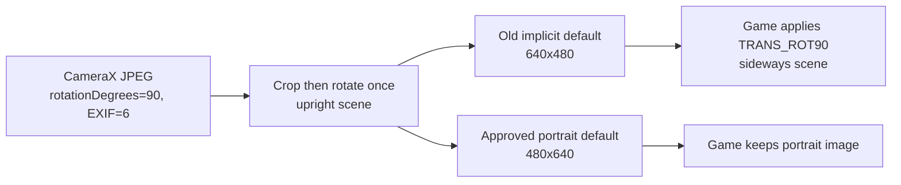

# Camera troubleshooting and device evidence — PR 175

This is the investigation and reproducible device-test handoff for
[PR 175](https://github.com/H3nb/JL-Mod-Plus/pull/175), investigated on 2026-10-18.
Read [MMAPI camera](mmapi-camera.md) first for the current supported contract.
[Java ME camera history](camera-java-me-history.md) explains the specification and
vendor evidence behind the approved default policy. Historical proposals are not
implementation instructions.

## Current result

The reported sideways Miami Nights 2 photo involved two distinct boundaries:

1. CameraX metadata and the encoder produced upright pixels. The game's observed
   `getSnapshot(null)` path then rotated landscape images by `TRANS_ROT90` to fit
   its portrait working image. The emulator's unconditional landscape default
   conflicted with that expectation; a second global encoder rotation would break
   independent MIDlets.
2. Independent testing found real emulator framing defects: a differently shaped
   PreviewView exposed content outside the shared crop, and filtered bitmap
   scaling sampled pixels outside that crop. Both are fixed.

Automatic dimensions now follow the full virtual screen once at MIDlet launch:
480 x 640 for portrait, 640 x 480 for landscape/square. Media configuration can
select either size explicitly and choose the default rear/front camera. Explicit
MIDlet dimensions and capability overrides retain their documented precedence.
The user confirmed the automatic portrait build worked as expected in Miami.
No game-name, device-model, Android-version or fixed-angle workaround was added.

The PR remains draft/open and must not be merged as part of this investigation.
The branch includes alpha through `450c6eac35ecaab2f95194998d12d2fd3d999fde`.

## Where to start in the code

Paths below are relative to `app/src/main/java/`.

| Concern | Owner / starting point |
| --- | --- |
| Requested sizes, encoding validation and lens precedence | `io/github/h3nb/jlmodplus/mmapi/camera/CameraCaptureOptions.kt` |
| Launch-time profile/default dimensions | `javax/microedition/shell/MicroLoader.java` |
| Automatic capability strings versus profile overrides | `io/github/h3nb/jlmodplus/mmapi/camera/CameraCapabilities.kt` |
| Player/API state and guest calls | `io/github/h3nb/jlmodplus/mmapi/camera/CameraCapturePlayer.kt`, `CameraCall.kt` |
| CameraX binding, shared ViewPort, target rotation, permission and lifecycle | `io/github/h3nb/jlmodplus/mmapi/camera/CameraRuntime.kt` |
| Fitted preview bounds and padding | `io/github/h3nb/jlmodplus/mmapi/camera/CameraPreviewContainer.kt` |
| JPEG decode, crop, one rotation, fit/padding and final bytes | `io/github/h3nb/jlmodplus/mmapi/camera/CameraSnapshotEncoder.kt` |
| Media form, persisted fields and preset equality | `io/github/h3nb/jlmodplus/config/ConfigComposeBridge.kt`, `ConfigFormState.java`, `ProfileModel.kt`, `ProfileJson.kt`, `ProfileConfigMatcher.kt` |
| Toolbar/menu visibility, packing and action dispatch | `javax/microedition/shell/RuntimeMenuCompose.kt` |

The settings are additive JSON-v7 fields: `CameraDefaultFacing` uses rear `1` or
front `0`; `CameraResolution` uses automatic `0`, portrait `1`, landscape `2`.
Missing fields mean rear/automatic without forcing a profile rewrite. A generic
camera request may fall back when the preferred lens is absent; a named device
request is strict. Toolbar swaps are session-only and do not rewrite preferences.

## Root-cause evidence

Starting branch head was `2ea018fd36ca35a24c5304512fe2519114aec8af` on
`feat/camera-preview-snapshots`. The reported installed build was
[CI 2741](https://github.com/H3nb/JL-Mod-Plus/actions/runs/39119113716).
The following rear capture was recorded at device time 20:52:49 +08:00:

| Boundary | Observed value |
| --- | --- |
| Sensor / display rotation | 90 degrees / `ROTATION_0` |
| Preview and ImageCapture resolution | 1280 x 960 |
| Both use cases' crop | `(280, 0)-(1000, 960)` |
| ImageProxy / decoded raw JPEG | 1280 x 960 / 1280 x 960 |
| `rotationDegrees` / raw JPEG EXIF orientation | 90 degrees / 6 |
| `getSnapshot` argument / override | null / absent |
| Exact returned JPEG | 640 x 480, quality 90, upright scene pixels |
| Next executed MIDP image operation | region 640 x 480, transform 5 (`TRANS_ROT90`) |

Temporary diagnostics collected raw CameraX JPEG and exact returned bytes before
control reached the guest. Comparing pixels showed that the encoder's clockwise
rotation correctly matched the scene. EXIF 6 agreed with the proxy metadata;
applying both would rotate twice. Neither BitmapFactory nor the MIDP decode path
added another EXIF transform.

The installed game `res.jar` was read through shared storage without modification.
Its SHA-256 was `fcd0d7cffbf26b6ea5c147c209063a44f118fad823f9cd260aadf5e72b1c60c6`.
`javap -p -c` located class `a` calling `getSnapshot(null)`, decoding the bytes,
checking `height < width`, then calling `Image.createImage(..., 5)`. Device logging
confirmed execution of that branch. Its 480 x 640 working photo, 48 x 64 thumbnail
and portrait viewfinder establish the observed path's portrait expectation.
They do not establish a universal historical phone-camera convention.



The first additional pixel rotation was in game processing. The earliest default
geometry mismatch was in the emulator, before encoding. This distinction is why
the fix changes the coherent default source/ViewPort/output geometry, rather than
counter-rotating every returned image or classifying the game as defective.

## Independent framing fixes

The independent debug MIDlet decodes snapshots and draws them with `drawImage` or
`ImageItem` without transforms. Before the fix, resizing its direct video region
from 320 x 240 to 240 x 320 exposed extra content above/below the shared crop, while
snapshot bytes retained the central crop. Both use cases reported equal crop
metadata. The first divergence was presentation: a full-container `FIT_CENTER`
PreviewView could expose buffer content outside the fitted crop.

`CameraPreviewContainer` now fits the logical source aspect into guest bounds,
centers the child, and supplies black padding. Its PreviewView uses `FILL_CENTER`
and clips the shared ViewPort crop. Guest display resizing remains presentation-only.

The existing asymmetric-pixel test
`cropExcludesOutsidePixelsBeforeScalingAndRotation` also failed on the original
encoder: scaling sampled magenta pixels outside a cyan crop. A drawBitmap source
rectangle alone did not clamp filtered sampling. The encoder now creates a
crop-bounded bitmap before filtering and recycles it when distinct from its input.
This may add one bounded source-crop allocation, at most 16 MiB of ARGB pixels.

## N73 left-aligned viewport: a separate game layout

The user later reported that Miami Nights 2's N73 variant had a left-aligned
portrait preview on virtual 240 x 320, unlike the tested SE K800i variant. The
camera was covered; the dark image itself was not a capture failure.

Read-only inspection of the installed N73 `res.jar`, SHA-256
`92945c2a443e92ddbdc8ed2d5bc84e19c3efa700f028750d7c89c432cd462e70`,
found class `a`'s relevant branch calling `setDisplayLocation(0, c + 2)` and
`setDisplaySize(e - 4, d - 4)`. Its static initialization gives `c=24`,
`d=320-48=272` and `e=((240<<8)/320)*272>>8=204`: the requested rectangle
is `(0,26,200,268)`. The SE variant instead computes a horizontal offset.

With N73 open at TAKE PICTURE on the updated physical build, a read-only activity
view dump showed:

```text
Canvas video root:       0,0-1280,1706
CameraPreviewContainer: 0,139-1067,1568
PreviewView child:       0,3-1067,1426
```

Scaling `(0,26,200,268)` by the Canvas mapping produces exactly those container
bounds after rounding. The portrait PreviewView is centered inside the requested
container, including three pixels of top/bottom padding. There is no lost emulator
offset. No TAKE or ACCEPT was pressed for this check, and no game file was edited.

[JSR-135 setDisplayLocation](https://docs.oracle.com/javame/config/cldc/opt-pkgs/api/mm/jsr135/javax/microedition/media/control/VideoControl.html)
uses coordinates relative to the Canvas's upper-left corner. A universal implicit
centering change would override explicit guest positioning. This finding therefore
does not justify a production alignment fix. Any optional compatibility override
would need a separate approved contract, without game/device-name detection.

For future read-only geometry checks, scope the activity dump explicitly:

```text
adb -s SERIAL shell dumpsys activity -p io.github.h3nb.jlmodplus.debug javax.microedition.shell.MicroActivity
```

Avoid an unfiltered `dumpsys activity top`; it can include unrelated tasks.

## Validation evidence and limits

These are separate checkpoints; earlier explicit-size geometry tests do not imply
that every later default policy was tested in the same full matrix.

| Checkpoint | Evidence |
| --- | --- |
| Shared crop/rotation fix | 24 physical captures: rear/front x Android display rotations 0/90/180/270 x output aspects 4:3, 3:4 and square; exact dimensions and decodable bytes |
| Preview versus exact returned image | Same composition; measured correlation 0.970–0.999 rear and 0.864–0.995 front; moving exposures are not identical frames |
| Display and Player paths | Canvas and Form/VideoItem; hidden preview; stopped capture; restart; background failure then resume; close and controlled capture-after-close failure |
| Virtual-screen defaults | Virtual 240 x 320 returned 480 x 640 rear/front; virtual 320 x 240 returned 640 x 480 rear/front; advertised/source sizes agreed |
| Explicit size and session stability | PNG 640 x 480 overrode portrait default; display resize did not change the session default; automatic size plus forced landscape returned 640 x 480 |
| Miami after default update | User confirmed expected behavior; this confirmation is distinct from the earlier instrumented capture evidence |
| Persisted Media settings, physical Android 16 | Saved front/landscape on portrait virtual screen returned 640 x 480; real `config.edit` selection of rear/portrait persisted values `1`/`1` and returned 480 x 640 |
| Real toolbar camera swap | Destination changed front→rear after rear→front swap; subsequent JPEG remained 480 x 640; explicit PNG 640 x 480 won; close removed the icon |
| Selected local JVM tests | 366/367 passed; an existing private-files test could not create a symlink without the Windows privilege |
| Focused physical instrumentation | 21 tests passed for Media choices, toolbar action/availability/busy/overflow and camera API/encoder/cancellation; three UI cases passed again after localized copy revisions |
| Screenshot references and lint | 12 Media/navigation references visually reviewed; all 122 previews and normal-model lint passed before the compact-toolbar follow-up |
| Localization follow-up | Terminology/grammar reviewed in 12 catalogs; all 12 camera resources present in all 38 translated locales; resource compilation passed |
| Remote checkpoint `3c559c544` | [Android CI](https://github.com/H3nb/JL-Mod-Plus/actions/runs/39136819799) passed fresh native assembly, full app/dexlib JVM tests, instrumentation assembly, lint and screenshot validation |
| Compact-toolbar follow-up | 11 layout JVM tests and five physical UI tests passed, including camera action/busy state, cutout packing and 40dp-high landscape hit bounds; five changed references visually reviewed, all 122 screenshot previews passed again |

The display-rotation matrix used ADB-controlled Android display rotation, not four
handheld poses. The independent debug MIDlet exercises the real guest runtime,
but is not a test of JAR conversion/installation. The broader UI suite on the
Indonesian phone locale was not green: existing tests use hardcoded English
selectors such as Start, Apply and OK. It is not counted as passing.

Physical permission deny/regrant, driver contention/absence, host destruction
during exposure and a multi-device/OEM sweep remain unqualified. API state and
cancellation tests do not replace those driver scenarios. See the qualification
matrix in [MMAPI camera](mmapi-camera.md) when extending coverage.

### Device and data provenance

Device testing used the connected physical Android 16 phone. Updates used
`adb install -r` with the original debug signing certificate, SHA-256
`9f1b019ee11f2edb30122b894c634ac5cf813ddeed012ee3b9e1e59f7b63b449`.
No uninstall, clear-data, root, game-JAR editing or old-save restoration occurred.
The initial diagnostic game photo was not accepted. The user subsequently opened,
configured and played Miami; normal config, keyboard-layout and RMS writes must
not be mistaken for test-induced data deletion. Hash checks retained converted
assets and matched current files across the owned-fixture cleanup checkpoint.

Local device APKs reused all 13 native libraries from CI 2741 through an external
init script and `jlmodNativeBuild=false`; their bytes were checked equal. That
setup was not committed. Local APK assembly is not fresh-native-build evidence;
use the PR's current CI results for complete native assembly and Linux JVM tests.
Temporary photo logging was removed. Photos were inspected locally, not committed
as repository fixtures. Owned probe catalog/config/data and private photos were
removed after testing.

## Troubleshooting without repeating the investigation

| Symptom | Inspect first | Avoid assuming |
| --- | --- | --- |
| Preview upright, game photo sideways | Exact `getSnapshot` bytes, actual request/default dimensions, then guest image transforms | That CameraX or EXIF rotated twice merely because the game display is sideways |
| Independent decoded bytes sideways | Proxy rotation, target rotation, raw JPEG/EXIF and encoder rotation in that order | A fixed angle or sensor mounting inferred from model/version |
| Preview shows more content than snapshot | Shared ViewPort/crop metadata, fitted PreviewView bounds and clipping | That changing output width/height repairs source framing |
| Preview rectangle is not centered | Guest setDisplayLocation/Size calls and mapped Android view bounds; N73 example above | That every MIDlet requests a centered region or that the emulator should override explicit coordinates |
| Colored edge pixels outside crop | Crop-bounded bitmap and filtered sampling | That drawBitmap's source rectangle clamps its filter |
| Wrong unspecified dimensions | Profile resolution, virtual screen at launch, automatic encoding discovery and explicit property overrides | That current preview bounds or later display resize select the default |
| Wrong lens | Named locator, session override, configured default, availability | That Android camera IDs equal devcam numbers |
| Missing/disabled swap action | Active foreground camera, both directions available, capture/rebind busy state, toolbar packing and menu fallback | That every camera source exposes two usable directions |
| Probe stops reporting | Guest lifecycle, command id, exception/crash and process focus | That a fixture/class-loader failure proves a production camera failure |

If new diagnostics are needed, compare the raw CameraX JPEG, proxy metadata,
exact returned bytes and guest image operation at the same capture boundary.
Use a stationary asymmetric TOP/LEFT target; distinguish scene rotation from the
width/height rectangle and distinguish mirroring from rotation. Keep diagnostics
bounded, local and temporary. Never add a host-backend reference to the probe:
that caused a guest class-loader stall during this investigation. Observe the
lens through host state/UI; the independent camera path stays Java ME-only.

## Reproduce with the owned debug MIDlet

Read [Build and validation](development.md) for the current Android toolchain.
Build/install the matching debug and androidTest APKs. Run only while the device
is available for testing and no user guest session is active. The opt-in test opens
no hardware during ordinary test runs.

```text
adb -s SERIAL shell am instrument -w \
  -e class io.github.h3nb.jlmodplus.mmapi.camera.CameraDeviceProbeTest \
  -e cameraDeviceProbe true -e cameraProbeHold true \
  -e cameraProbeScreenWidth 240 -e cameraProbeScreenHeight 320 \
  -e cameraProbeDefaultFacing 0 -e cameraProbeResolution 2 \
  io.github.h3nb.jlmodplus.debug.test/androidx.test.runner.AndroidJUnitRunner
```

The example is one command; use your shell's continuation syntax. Setup creates
only `Camera175Probe` in the current workdir's converted/config/data directories
and its catalog entry. It copies the current debug APK for the fixture classes;
recreate it after changing debug fixture code. It does not change the workdir
preference. Reusing an owned fixture requires `-e cameraProbeReuse true`.
Additional setup arguments: `cameraProbeOrientation` and the values in the settings
table above. The held instrumentation session stops after 20 minutes or its stop file.

Write a local UTF-8 `command.properties` containing, for example:

```properties
id=rear-open-001
action=open
locator=capture://devcam0
```

Transfer it without putting images into shared storage:

```text
adb -s SERIAL push command.properties /data/local/tmp/camera175-command.properties
adb -s SERIAL shell run-as io.github.h3nb.jlmodplus.debug cp /data/local/tmp/camera175-command.properties files/camera175-probe/command.properties
adb -s SERIAL shell run-as io.github.h3nb.jlmodplus.debug cat files/camera175-probe/report.properties
```

Use a new id for every command and wait for the matching report before continuing.
Supported actions: `open`, `capture`, `preview`, `display`, `hide`, `stop`, `start`,
`close`. Open defaults to direct Canvas video; `mode=form` uses Form/VideoItem.
`display` takes `width` and `height`. Capture accepts an optional `encoding` value,
for example `encoding=png&width=640&height=480`; omitting it tests null. It hides the
live preview to display the decoded result; use `preview` to resume live viewing.

Reports contain state, advertised/source dimensions and an error when one occurs.
Successful captures also contain decoded width/height, byte count and a private
`<id>.snapshot` filename. For byte comparison, export with a binary-safe local
Python subprocess; do not route JPEG/PNG through a text decoder:

```python
from pathlib import Path
from subprocess import check_output
Path("snapshot.jpg").write_bytes(check_output([
    "adb", "-s", "SERIAL", "exec-out", "run-as",
    "io.github.h3nb.jlmodplus.debug", "cat",
    "files/camera175-probe/CAPTURE-ID.snapshot",
]))
```

End the held instrumentation session by touching
`files/camera175-probe.stop` through run-as. Close the probe runtime before cleanup.
Run the same opt-in instrumentation command with `-e cameraProbeAction cleanup`
and without `cameraProbeHold`. Cleanup verifies the owned descriptor before
removing its catalog entry, converted/config/data directories and private output.
Remove `/data/local/tmp/camera175-command.properties` and any local photos after
review. Never point this fixture cleanup at a real MIDlet.

## Sources used

- [JSR-135 VideoControl](https://raw.githubusercontent.com/shinovon/J2ME_Docs/master/docs/jsr135/javax/microedition/media/control/VideoControl.html): snapshot/display contract and the null-format default.
- [CameraX capture callback](https://developer.android.com/reference/androidx/camera/core/ImageCapture.OnImageCapturedCallback) and [crop configuration](https://developer.android.com/media/camera/camerax/configuration#crop-rect): proxy rotation and shared sensor crop; source version inspected was 1.6.2.
- [J2ME Loader camera controller](https://github.com/nikita36078/J2ME-Loader/blob/13e29830632464719a643043e1113310fe6e64cc/app/src/main/java/javax/microedition/media/CameraController.java): JPEG decode and metadata rotation comparison.
- [Official Android image helper](https://github.com/android/camera-samples/blob/2f10e46fc7a09f7208f8d6de72482ecf3e5fb85a/core-camera/src/main/java/com/android/camera/core/image/ImageUtils.kt): proxy rotation and separate mirroring.
- [GrapheneOS preview ratio](https://github.com/GrapheneOS/Camera/blob/fc75d0d5dd574240910ef99b0dfe98e0aadb500f/app/src/main/java/app/grapheneos/camera/ktx/PreviewView.kt): aspect-constrained presentation; its photo policy is not this emulator's contract.
- [KEmulator capture player](https://github.com/shinovon/KEmulator/blob/main/src/media/emulator/media/capture/CapturePlayerImpl.java): desktop webcam comparison, not handset-orientation evidence.

No third-party camera implementation was copied into the fix.
