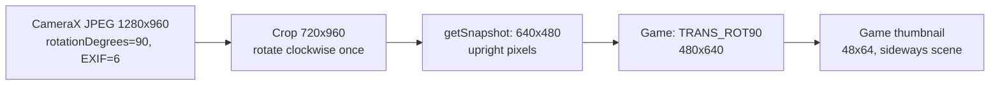

# PR 175 camera device investigation

## Scope and identities

Investigation on 2026-10-18, using the physical Android 16 device connected by USB.
Starting PR head: `2ea018fd36ca35a24c5304512fe2519114aec8af`, branch
`feat/camera-preview-snapshots`, draft [PR 175](https://github.com/H3nb/JL-Mod-Plus/pull/175).
The reported installed CI build is [run 2741](https://github.com/H3nb/JL-Mod-Plus/actions/runs/39119113716).
The installed debug APK was copied before updates. Its signing certificate matched
the local build (`9f1b019ee11f2edb30122b894c634ac5cf813ddeed012ee3b9e1e59f7b63b449`).
Device updates used `adb install -r`; there was no uninstall, clear-data, root, or
modification of the installed game JAR. Photos were inspected locally and are not
repository fixtures. The game photo was not accepted into the user's saved captures.

## Observations and first additional rotation

Miami Nights 2's TAKE PICTURE and PREVIEW screens reproduced the reported difference.
Temporary diagnostics recorded one capture at device time 20:52:49 +08:00:

| Boundary | Observed value |
| --- | --- |
| Rear sensor / display rotation | 90 degrees / `ROTATION_0` |
| Preview and ImageCapture resolution | 1280 x 960 |
| Both use cases' crop | `(280, 0)-(1000, 960)` |
| ImageProxy / decoded JPEG | 1280 x 960 / 1280 x 960 |
| ImageProxy rotation / raw JPEG EXIF orientation | 90 degrees / 6 |
| `getSnapshot` parameter / selected override | null / absent |
| Exact returned JPEG | 640 x 480, quality 90, upright scene pixels |
| Next MIDP image operation | source 640 x 480, region 640 x 480, transform 5 |

The raw JPEG and output were collected before the byte array reached guest code.
Comparing their pixels showed that the encoder's clockwise rotation produces the
correct scene orientation. EXIF 6 agrees with the proxy metadata; applying it again
would rotate twice. `BitmapFactory` and the MIDP image decode path do not add that
second EXIF transform.

The installed `res.jar` was accessed read-only through shared storage, with SHA-256
`fcd0d7cffbf26b6ea5c147c209063a44f118fad823f9cd260aadf5e72b1c60c6`.
Inspection with `javap -p -c` located the camera path in class `a`. It calls
`getSnapshot(null)`, decodes the returned bytes, and, on the observed branch, checks
`height < width` before calling `Image.createImage(image, 0, 0, width, height, 5)`.
MIDP transform 5 is `Sprite.TRANS_ROT90`. Device logging confirmed this call actually
ran, rather than merely existing in an unused branch. Its later sampling builds a
48 x 64 thumbnail, with a 480 x 640 working photo. Together with its portrait
viewfinder, this establishes that this game path expects a portrait photo. It does
not establish which physical-phone convention the game was written against.

The first additional quarter-turn is therefore in guest processing after
`getSnapshot()` returns. Calling this a game bug would go beyond the evidence:
the PR forces both an unspecified source and an unspecified snapshot into 640 x 480,
which triggers the game's portrait-normalization branch. Correct scene rotation
inside that landscape rectangle does not prove that this default geometry is the
right compatibility policy. No name, device, Android-version, or fixed-angle
override was added to the emulator to counteract it.

## Independent emulator defects

The independent `CameraSnapshotMidlet` decodes `getSnapshot()` bytes and displays
them using `Graphics.drawImage` or `ImageItem`, without a transform. Its commands,
raw returned files and reports are kept outside game-owned data.

Before the fix, changing its direct-video display from 320 x 240 to 240 x 320
revealed extra scene content above/below the shared crop. The encoded bytes retained
the central 4:3 crop. Both CameraX use cases reported the same crop, so the first
framing divergence was in presentation: a full-container `PreviewView` using
`FIT_CENTER` could draw buffer content outside the fitted crop into the rest of
its own bounds.

`CameraPreviewContainer` now measures the PreviewView to fit the logical source
aspect inside guest bounds, with a centered child and black background. The View
uses `FILL_CENTER`, matching the shared ViewPort; its bounds clip the camera buffer.
Guest display resizing remains presentation-only and does not select another crop.

The existing physical instrumentation test
`cropExcludesOutsidePixelsBeforeScalingAndRotation` also failed on the original
encoder: filtered scaling sampled magenta pixels beyond a cyan source crop.
Constraining only `Canvas.drawBitmap`'s source rectangle did not clamp that sampling.
The encoder now creates a crop-bounded bitmap before filtering. It recycles that
temporary bitmap when distinct from the caller's source. The existing pixel/byte
limits and failure handling remain in force; peak allocation can increase by up to
one bounded source crop (at most 16 MiB of ARGB pixels).

## Specification and open-source comparison

- [JSR-135 VideoControl](https://raw.githubusercontent.com/shinovon/J2ME_Docs/master/docs/jsr135/javax/microedition/media/control/VideoControl.html)
  defines a snapshot of displayed content, format/resolution parameters, and the
  first advertised format as the null-parameter default. It does not require a
  handset-specific extra quarter-turn.
- [CameraX capture callback](https://developer.android.com/reference/androidx/camera/core/ImageCapture.OnImageCapturedCallback)
  defines `rotationDegrees` as the clockwise rotation needed to match target rotation.
  [CameraX configuration](https://developer.android.com/media/camera/camerax/configuration#crop-rect)
  describes shared sensor crop coordinates and preview/capture agreement after crop
  and rotation. The actual source version inspected was CameraX 1.6.2.
- [J2ME Loader camera controller](https://github.com/nikita36078/J2ME-Loader/blob/13e29830632464719a643043e1113310fe6e64cc/app/src/main/java/javax/microedition/media/CameraController.java)
  decodes JPEG and rotates by proxy metadata. Its implementation is a useful comparison,
  not evidence that every aspect of its lifecycle/geometry should replace this PR.
- [Official Android image helper](https://github.com/android/camera-samples/blob/2f10e46fc7a09f7208f8d6de72482ecf3e5fb85a/core-camera/src/main/java/com/android/camera/core/image/ImageUtils.kt)
  also applies proxy rotation after decoding; mirroring is an explicit separate choice.
- [GrapheneOS preview ratio](https://github.com/GrapheneOS/Camera/blob/fc75d0d5dd574240910ef99b0dfe98e0aadb500f/app/src/main/java/app/grapheneos/camera/ktx/PreviewView.kt)
  constrains preview layout aspect using camera geometry. Its sensor-oriented photo
  policy is distinct from this emulator's logical source contract, but supports
  constraining the preview bounds rather than compensating with extra image rotation.
- [KEmulator capture player](https://github.com/shinovon/KEmulator/blob/main/src/media/emulator/media/capture/CapturePlayerImpl.java)
  is a desktop-webcam comparison, not proof of Android sensor or feature-phone semantics.

No third-party implementation was copied into the fix.

## Compatibility assessment at the first device checkpoint

Upright pixels, exact explicitly requested sizes, and consistent preview/snapshot
handedness remain the proposed invariants. Globally counter-rotating pixels would
break the independent MIDlet. However, the existing fixed landscape source/default
is an implementation choice, not a JSR-135 requirement and not a reason to reject
portrait output for requests that omit dimensions. The independent tests qualify
the implemented geometry; they do not settle this policy.

The follow-up [historical capability and orientation study](camera-java-me-history.md)
separates specification requirements, vendor evidence, the game's expectations,
and a proposed geometry change. That proposal has not been implemented. The
installed game's profile was not changed during this investigation.

## Validation and remaining limits

The final executable state was built and installed without the temporary capture
logging/dump code. APK assembly and instrumentation assembly passed. For physical
qualification the local build used `jlmodNativeBuild=false` and an external init
script to package the original CI APK's native libraries: all 13 `.so` entries were
verified byte-for-byte equal. No generated native workaround or init script was
added to the repository. A complete fresh native rebuild/release build is not
claimed. Lint and JVM validation were subsequently checked with the normal
native-enabled project model.

| Check | Result |
| --- | --- |
| Camera capability/options and Manager capability JVM tests | 17 passed |
| Physical instrumentation: preview layout, encoder, Camera Player and cancellable calls | 17 passed |
| `:app:lintEmulatorDebug`, normal native-enabled model | Passed, 0 errors, 20 warnings, 2 hints; no camera findings |
| Rear/front x display rotations 0/90/180/270 x output ratios 4:3, 3:4, square | 24 final-build captures, exact dimensions and decodable formats |
| JPEG, PNG and null/default requests | Passed; null/default returns 640 x 480 JPEG |
| Logical source 3:4 and square, independent of output size | Additional captures passed |
| Real Canvas and Form/VideoItem | Preview and direct decoded snapshot display passed |
| Hidden preview / stopped Player / restart | Captures passed; stopped state 300, restarted state 400 |
| Home/background capture, Library reselection/resume | Controlled MediaException while backgrounded; capture passed after resume |
| Player close / capture after close | Closed state 0; controlled IllegalStateException |
| Miami Nights 2 on final build | Shared crop now visible with padding; game still explicitly rotates its thumbnail |
| Owned fixture and temporary on-device images | Removed; installed game retained |
| `git diff --check` | Passed |

The matrix used ADB-controlled display rotations on the physical device, rather
than claiming four independently hand-held device poses. Rear target features
included asymmetric cables, printed packaging and a marked power adapter; the front
target was a notebook with readable text. The preview's fitted image region and
the snapshot's non-padding region were compared after resizing to 160 x 120 grayscale.
For all 24 pairs, untransformed correspondence scored highest compared with a
horizontal mirror or 90/180/270-degree alternatives. Pearson correlation was
0.970-0.999 rear and 0.864-0.995 front. These scores support the visual framing,
orientation and handedness comparison; they are not assertions of identical
exposures or a general quality/performance benchmark.

The game JAR, converted payload, descriptor, icon and profile files retained their
baseline checksums. Both saved-capture RMS files also retained their checksums
(no ACCEPT was pressed). Ordinary game-state RMS files changed during game launch
and user navigation; they were neither cleared nor restored over the user's progress.

Physical permission deny/regrant, camera contention/absence, host destruction in
the middle of exposure, and a multi-device/OEM sweep remain unqualified. Automated
call/Player tests cover cancellation and state contracts, but do not replace those
driver/lifecycle scenarios. The independent MIDlet runs in the real guest process
as a debug fixture; it is not a qualification of the JAR conversion/install path.

At this checkpoint the emulator framing/crop defects were fixed, while compatibility
between the implicit default geometry and the game's portrait expectation remained
unresolved. The approved follow-up below changes that default for user testing.
The PR stays draft/open;
no merge or remote publication was performed during this investigation.

## Approved virtual-screen default update

After the historical study, the user approved implementing a virtual-screen-based
default and installing it for manual Miami testing. The full virtual screen at
launch selects 480 x 640 for portrait, 640 x 480 for landscape/square. This is held
for the MIDlet session, including new Players and host reattachment. For automatic
screen dimensions, phone-keyboard portrait or a forced profile orientation takes
precedence over the Android display's orientation before the host request settles.
Otherwise the initial resolved virtual dimensions determine orientation.

Automatic advertised dimensions, default source geometry and unspecified snapshot
sizes use the same choice. Explicit sizes and explicit advertised profile defaults
retain precedence. CameraX crop/rotation handling and encoder transforms are
unchanged; the portrait default changes the shared source/ViewPort aspect as well
as the returned image rectangle. No MIDlet/device-name condition is involved.

The installed APK SHA-256 is
`81de08e3942fd76ae0cf46d2c5175328bd0d1c3690837d4926fa390286321824`.
Installation used `adb install -r` with the matching debug certificate. Its 13
native libraries remain byte-identical to CI 2741, using the external build setup
described above. All files under the installed Miami converted/config/data
directories retained their before/after SHA-256 values during this update.

Validation of this update:

- 19 JVM tests passed: capability/default parsing and Manager discovery.
- 18 physical Android tests passed: Player/session stability, encoder, preview
  layout and cancellable calls.
- Independent MIDlet on virtual 240 x 320: rear/front null snapshots decoded as
  480 x 640 JPEG, matching advertised and source dimensions.
- Independent MIDlet on virtual 320 x 240: rear/front null snapshots decoded as
  640 x 480 JPEG, matching advertised and source dimensions.
- Portrait session plus explicit PNG 640 x 480 returned that exact size. A display
  resize to 320 x 240 still returned 480 x 640 for the next null snapshot.
- Automatic dimensions plus forced landscape returned 640 x 480.
- All seven captured byte arrays decoded successfully. Owned fixture/config/data
  and private probe images were removed afterward.

These checks qualify the changed default-resolution path; they do not repeat the
earlier 24-case visual matrix or establish a final visual pass for Miami under the
new policy. The user will test Miami on the installed build.

## Manual probe

`CameraDeviceProbeTest` is opt-in (`-e cameraDeviceProbe true`) and opens no hardware
in ordinary test runs. Setup adds only its owned `Camera175Probe` catalog entry,
converted directory and config in the current workdir. It does not change the user's
workdir preference. Use `-e cameraProbeReuse true` to relaunch an existing probe.
Use `-e cameraProbeHold true` to retain the instrumentation session while driving it;
write `files/camera175-probe.stop` through `run-as` to end the session.

Commands are Java properties in private `files/camera175-probe/command.properties`:
unique `id`, `action`, and optional `locator`, `mode`, `encoding`, `width`, `height`.
Actions are `open`, `capture`, `preview`, `display`, `hide`, `stop`, `start`, `close`.
`mode=form` uses a real MIDP Form/VideoItem; the default is direct Canvas video.
Read `report.properties` for the matching id and state/error. A capture writes exact
returned bytes into `<id>.snapshot`; an absent `encoding` tests `getSnapshot(null)`.
After ending the runtime, run the same opt-in test with
`-e cameraProbeAction cleanup`; it verifies the fixture descriptor and removes only
its owned entry/directories and private probe output. Do not run this manual launcher
against an unrelated active guest session.
